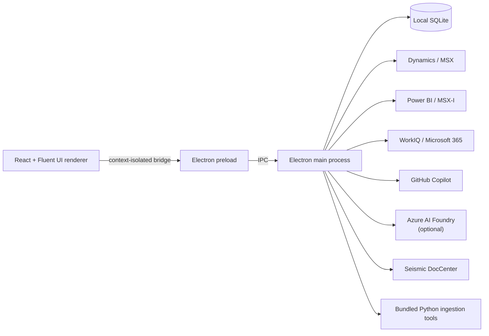

# SE Assist

SE Assist is a local-first Windows desktop workspace for Solution Engineers. It brings account, opportunity, milestone, communication, meeting, task, workload, Azure-consumption, and organizational context into one place, then applies grounded AI to help an SE decide what matters and produce useful work.

The application is intentionally not a generic CRM, mailbox, or chatbot. Its purpose is to connect the systems an SE already uses, preserve the links between evidence and work, and turn those signals into reviewable actions without silently inventing data or changing providers.

This public repository contains application source, documentation, and synthetic test fixtures. It does not include a customer roster, databases, research vault, sign-in caches, backups, or raw communications. Connect your own authorized accounts and save your active roster during setup.

## Product principles

- **Local ownership.** Durable application data lives in a local SQLite database. SE Assist has no active cloud application backend and does not synchronize that database to a hosted service.
- **Grounded output.** AI features receive bounded, feature-specific context and identify the connected source used for their answer.
- **Human approval.** Suggestions, drafts, tasks, workload links, and milestone updates remain reviewable. The user decides what becomes durable work.
- **Fail loudly.** Authentication, provider, permission, data-source, and rate-limit failures are surfaced. SE Assist does not silently switch identities, AI providers, or data sources.
- **Deterministic where possible.** Database joins, account resolution, date ranges, rendering, persistence, and workflow state are handled in code. Models are used for interpretation and synthesis, not as a substitute for application logic.

## What the application does

### Daily work and account management

- **Action Center** combines today's meetings, milestone warnings, active workloads, accounts to re-engage, the embedded workload workspace, and an agenda calendar.
- **Deep Research** (under Action Center) finds email already pulled into SE Assist, by customer account or keyword, and turns a chosen email into a saved research subject. See [Deep Research](#deep-research).
- **Customers** provides account workspaces with relationship context, opportunities, milestones, contacts, recent communications, workloads, research, consumption, and AI-generated analysis.
- **Milestones table, map, and timeline** expose active engagement milestones from different planning views.
- **HoK Activities** shows synced Dynamics activities.
- **Excellence Metrics** summarizes portfolio engagement and overdue-comment signals.
- **My Org** explores the Microsoft organization, account teams, relationships, schedules, and specialist discovery.
- **Influence Map** is a stakeholder influence map for one customer account. See [Stakeholder Influence Map](#stakeholder-influence-map).
- **User Home** owns connections, models, roster and SSP configuration, sync automation, backups, navigation, and local-data deletion.
- **Documentation** is the in-app current-state operating guide.

In an account glance, **Message in Teams** addresses the selected SSP, ATS, or AE and
prefills `Hi {first name}, can we talk about {account}?`. In a milestone detail popup,
**Message owner** keeps the milestone owner as the recipient and copies
`Hi {owner first name}, can we talk about this milestone {milestone name}.` as rich text,
with the milestone name linked to its exact MSX record. The action opens the owner's chat;
press **Ctrl+V** in Teams to paste the formatted message, then review and send it yourself.
The paste step preserves the named hyperlink without relying on Teams deep-link HTML rendering.
Opportunity-owner chats are unchanged. Missing names, milestone MSX links, clipboard failures,
and Teams-opening failures are reported explicitly. Nothing is sent automatically.

The saved TPIDs in **User Home → My Sales Accounts by TPID** are the authoritative active roster. The editor contains the complete list: **Save active roster replaces it**, rather than adding to it. Remove a TPID, confirm the archive, and its cached accounts, opportunities, milestones, communications, workloads, and Tasks disappear from active views and stop receiving account-specific sync, ingestion, or AI work. **Archive** and **Archive all** change membership only; they do not delete history, notes, transcripts, manual links, dismissals, or Work Outputs. Re-add the same TPID to restore that history and resume pulls. An empty saved list pauses account-specific work; unassigned/internal work remains available.

Detection is a preview and can include past-role accounts. Review the draft before saving; neither Microsoft sign-in nor routine ingestion activates detected accounts. Roster changes wait for running sync, ingestion, and account AI work to finish. After reactivating an account, use **Sync from CRM** to refresh its details; **Backfill** can fill a wider historical window if needed.

### Workloads, suggestions, and tasks

Workloads are local delivery records that can be linked to a real customer, SSP, opportunity, milestones, communication signals, stages, actions, assets, and local Tasks.

- **Suggest workloads** examines the last week of customer-linked emails, meetings, and Teams chats for the selected roster accounts. AI proposals are resolved to real TPIDs and stored as drafts with their evidence.
- Opening a suggestion exposes the account's active opportunities and milestones. A milestone can be selected only after its parent opportunity is included.
- Approving a suggestion creates a normal workload through the standard creation path and carries forward selected opportunity and milestone links.
- Dismissing a suggestion is permanent for that account and stable concept key. Future runs suppress the same concept even if the model rewords its title.
- **Discover** starts from one account and a user description, then identifies matching communication evidence and proposes a workload draft.
- Existing workloads can be saved as templates and applied to new or existing work. Templates preserve stages and actions.
- **Milestone AI** finds related signals, drafts milestone comments, and proposes HoK activities from the evidence linked to each milestone.
- Local **Tasks** can be assigned to a customer and optionally to a workload. They are independent from CRM HoK activities.
- Meeting transcript summaries can produce structured Tasks. Creation is idempotent: rerunning the same meeting action does not create duplicates or restore a task the user deleted.

### Communications, meetings, and work outputs

WorkIQ-backed ingestion pulls customer-related Outlook email, calendar events, and Teams chats into the local database. It links evidence to roster accounts, builds per-account profiles, and supports:

- recent-activity views and relationship signals
- meeting preparation, transcript retrieval, notes, summaries, and task extraction
- the Secretary todo scan of pulled customer email (hidden from Action Center for now), and reply drafting
- **Deep Research** search of pulled email, by customer account and keyword, and its saved research subjects
- the Work Agent's live Microsoft 365 investigation tools
- reusable **Work Outputs** for situation briefs, reply drafts, action checklists, and technical recommendations

Work Outputs persist each output area independently. A failed or access-limited area can be retried without discarding successful areas, and sources, gaps, model attribution, cancellation state, and created task links remain visible. Deep Research is where they are created and reopened.

The Action Center **Secretary** is hidden for now (`SHOW_SECRETARY = false` in `ActionCenter.jsx`); its scan, agents, and model pin remain so it can be restored. When shown, it reads only customer-linked email that ingestion has already stored in SQLite. It makes no WorkIQ calls, so its todos are only as current as the last **Pull new items** or auto-ingest run. It reads only email a pull stored and linked to a roster account; email beyond a pull's per-account cap is never stored.

- Each email uses the full stored body (secret-like values already redacted), then the condensed body, then the preview. Copies of the same message are merged, and conversations marked done are skipped.
- Before the model reads a body, web addresses are shortened to site and path: SafeLinks are unwrapped, query strings and fragments are dropped, and `…` marks the cut. Link text is kept, and each todo still opens its email from the stored Outlook link. Long tracking links otherwise made up most of the model input and slowed scans.
- The address saved by User Home → **Microsoft 365 sign-in** identifies email you sent. Without it, the scan says so rather than guessing.
- The coverage line shows the last pull time, body sources, merged copies, and emails that could not be read (protected or without text).
- Warnings name anything that limits coverage: a failed or degraded last pull, accounts the pull could not search, a pull still running, auto-ingest turned off, a stale pull, or undated emails.
- With no customer-linked email or no completed email pull stored, the scan fails with instructions to pull.
- Secretary has no research action. To research one of its emails, find it in **Deep Research**.

### Deep Research

**Action Center → Deep Research** replaces Secretary's former Solve panel. Like Action Center, it starts hidden for new users; switch it on in User Home → **Customize navigation**.

- **Find an email** lists the email ingestion already stored in SQLite, newest first, 20 at a time; **See more** at the bottom adds the next 20 older emails. It never reads the live mailbox, makes no WorkIQ calls, and shows the last pull time.
  - The **customer account** picker (left) lists only email linked to the chosen active account; type to filter the picker. Each account shows how many stored emails are linked to it, and two accounts with the same name show their TPID. **All customer accounts** includes active-account email and unassigned/internal email.
  - **Keyword search** (right) searches eligible stored email from active accounts or unassigned/internal work, or only the chosen account's. Archived-only email and archived account tags are hidden without deleting them. Every word must match the subject, sender, recipients, linked customer account, or stored body text.
  - Each email shows its customer account tags (up to three, then **+N more**), or **No customer account**. Links rejected by AI review are not account links.
  - If stored email changes between pages, for example when a pull finishes, the list says so and offers **Refresh**.
  - The former **Outlook folders** pane and its WorkIQ folder sync were removed; the database upgrade (migration 034) drops their tables and keeps stored emails and their account links. After updating, fully restart SE Assist (reloading the window is not enough) so the upgrade runs.
- Opening a result shows the stored email (full, condensed, or preview text, labeled as such). **Deep Research** saves it as a research subject and automatically starts the situation, action checklist, and reply areas. The technical recommendation runs when you ask a technical question.
- **Gaps — research and status** lists each open question the outputs raised, once, with its status: Open, Answered, Partly answered, Still open, Blocked, or Failed.
  - After outputs run, the questions are classified automatically (the Utility Model, if one is selected): work data (Microsoft 365), public documentation, ask a person, or research limitation. A failed classification is shown and waits for **Retry classification**.
  - **Research this gap** runs one focused search, through WorkIQ for work-data questions or a generic public search (customer and conversation details removed) for public-docs questions. A model then judges the evidence. An answer is kept only when its supporting quote appears verbatim in the retrieved evidence; otherwise the question stays open with a note. Questions for a person and research limitations are never researched.
  - **Research open gaps** researches up to 5 open or failed questions, one at a time, and stops at the first failure. **Stop gap research** stops it; earlier answers are kept.
  - An answer marks each output that lists the question **Needs refresh**. Refreshing that output uses the answer and no longer lists the answered question as a gap. A partial answer is kept until a later search improves on it.
  - If the technical recommendation has no question yet, classification suggests one from the open gaps and fills it in. It runs only when you choose.
  - Rows keep their order while a gap is researched; the order changes only when gaps are added, removed, classified, or no longer listed. The result appears under the question: the answer, a note that it stays open, or the error.
- **Research subjects** lists every saved subject, including research started from the former Solve panel, with each area's status. Every Solve action remains available: per-area retry, refresh, stop, refine, and copy; a reply-all draft in Outlook; and Task and workload creation.
- Errors give a plain title, what to do next, and the time of the last attempt. The original message is under **Technical details**.
  - When areas fail, a banner above the outputs names them. It offers **Open Microsoft 365 sign-in** or **Open GitHub sign-in** when an expired or missing sign-in caused the failure.
  - **Retry failed areas** retries them in order and stops at the first one that fails again. It skips areas waiting for a service cooldown or denied access.
- Research reads the source email again live through WorkIQ and runs only on GitHub Copilot with the selected model. It never uses Foundry. Protected (Microsoft Purview) email cannot be researched.
- One area or gap job runs at a time. Controls that must wait say what they are waiting for. **Copy** and source links stay available while research runs. Leaving the page stops the job; saved areas and answers are kept. Removing a subject deletes its saved research, including gap answers, but keeps the Tasks and workloads created from it.
- Opening a subject scrolls its panel to the top and moves keyboard focus to its heading. Up and Down arrows move through the email list, **See more** moves focus to the first new email, and closing an email returns focus to its row.

### Stakeholder Influence Map

**Explore Data → Influence Map** estimates who shapes a customer account's decisions. It uses only data already stored on the device for one roster account: linked email, calendar meetings, meeting transcripts, CRM contacts, and the account team. Nothing new is fetched.

> **Scores are inferred signals, not facts about people.** They come from who emails, invites, and speaks with whom in the account's linked data, and miss hallway conversations, calls without transcripts, and anything not linked to the account. Check the evidence before acting on it. The map is available for every roster account.

- **Who is scored.** Only people outside Microsoft. Microsoft senders and organizers still count as the people who loop customers in, but are never scored. A person is a *customer* when they are a CRM contact or share a contact's email domain (public mail domains such as gmail.com never count); everyone else is *external*.
- **Signal score.** Fixed rules recompute a 0–100 score each time an account opens; scores are never stored. Each component is scaled against the account's highest value, with a minimum count so one email or meeting cannot read as full strength:

  | Component | Weight | Counts |
  |---|---|---|
  | Email reach | 25% | emails sent, plus times on To or Cc |
  | Looped in | 20% | different people who included them, plus times added to a running thread |
  | Initiative | 15% | threads started and meetings organized |
  | Meeting presence | 20% | meetings organized, or invited to and not declined |
  | Conversation pull | 20% | how often someone else speaks right after them, and their share of the words, in transcripts |

  Without transcripts, conversation pull is left out and the other weights are rescaled. Emails and meetings with more than 20 recipients, cancelled meetings, and duplicate email copies are ignored, and the page shows how many.
- **Hidden influencers** are pulled in often but say little: high inbound (looped in by others, invited by organizers), low outbound (emails sent, threads started, meetings organized, share of words), deliberately added to a running thread or invited by two or more organizers, and at least three pieces of evidence. Tags (*Frequently looped in*, *Convenes meetings*, *Draws responses*, *Quiet observer*) also need three pieces of evidence.
- **Evidence.** Each person lists the emails, meetings, and transcripts behind their score, the raw signal counts, and why the score is what it is.
- **Microsoft contacts.** Clicking a person first lists the Microsoft people who were on the same emails or meetings, most shared first. Each email thread and each meeting (scheduled ones included) counts once. Broadcasts to more than 20 people, cancelled meetings, and declined invitations don't count; someone who spoke in a meeting's transcript counts as present. Up to 30 are shown, with the total when there are more. You usually appear, because the data is your own mailbox and calendar. Teams chats are not used, and the list changes no score and is not sent to the AI.
- **Analyze with AI** is optional and runs only on GitHub Copilot with the selected primary model, never Foundry. It judges observable stance (champion, blocker, neutral, unclear) and adopted suggestions for the top 25 people by score. The model gets each person's name, title, score, and signals under a handle (P1, P2, …), plus excerpts of the related emails and transcripts; email addresses become `[email]`; your notes and corrections are never sent. Each returned quote is marked **Verified** only when it appears word for word in the text the model was shown. Nothing is saved when the response is cut off or invalid. A saved analysis is labelled when the account's data or your exclusions change, and an analysis from an older analyzer must be deleted and rerun.
- **Your corrections.** Set a person's stance, add a private note (up to 500 characters), or exclude them. An excluded person is not ranked, their AI judgement is removed, and the model sees them only as "Hidden participant" without their words. Other people's scores do not change. **Delete AI analysis** keeps your corrections.

### Azure and product intelligence

- **Azure Consumption** queries Power BI/MSX-I semantic models for portfolio and account Azure Consumed Revenue. It provides fiscal, service, product, hierarchy, and trend views.
- A shared ACR query scheduler prevents uncontrolled parallel semantic-model queries. Capacity cooldowns, bounded recovery probes, persistent row caches, freshness labels, targeted refresh, and explicit authentication/capacity errors protect both reliability and user trust.
- **Anthropic consumption (XCR)** appears inside the collapsed **Apps** section, directly below Foundry Models, on the Azure Consumption portfolio and account pages. It loads when Apps is expanded and uses the ACR model's native `$ ACR` measure for `XCR - Anthropic`, with selected accounts/fiscal years, completed-month trends, exact USD totals, and customer drill-down. It is not a token-based estimate or a per-Claude-model breakdown. Product filters do not apply, and ordinary Azure ACR totals, charts, and snapshots remain unchanged.
- **Foundry Deep-Dives** (under Azure Consumption) queries the Foundry leadership semantic model for the configured TPID roster. It shows rolling-90-day token totals, offering mix, weekly offering/model/region trends, engagement history, and a customer/subscription/model matrix. Customer, subscription, region, week, provider, model, offering, and engagement filters stay in the renderer.
- Foundry Deep-Dives uses a 15-minute identity-scoped memory cache; **Refresh** bypasses it. The page separately labels when SE Assist queried Power BI and when the semantic model reports that it was refreshed. Usage rows are not persisted to SQLite, and a freshness-metadata failure is shown without hiding otherwise valid usage data.
- **Model Quotas** (under Azure Consumption), **Microsoft Products**, **Solutions**, and the local research dossier provide adjacent reference and discovery surfaces. Microsoft Products and Solutions start hidden from the sidebar; turn them on in **User Home → Customize navigation**.
- **Seismic** search runs inside an authenticated persistent Electron browser session so its OIDC token remains in the browser context.

## Architecture

Three complementary views explain the application at different levels. Each self-contained HTML includes reading notes, source anchors and links to the other views. Overview and runtime PNGs are 1920x1080; the detailed workflow is a zoomable 3200x2880 reference poster.

| View | Use it for | Interactive HTML | PNG |
|---|---|---|---|
| Solution overview | Introduce the SE workspace, six capability groups, principal workflows and local-first value | [Overview](docs/architecture/se-assist-overview.html) | [PNG](docs/architecture/se-assist-overview.png) |
| Runtime & trust boundaries | Explain shell/guest renderers, isolated preload, privileged main, subprocesses, identity, local state and remote calls | [Runtime](docs/architecture/se-assist-runtime.html) | [PNG](docs/architecture/se-assist-runtime.png) |
| Data workflow & components | Follow inbound reads, processing, storage and UI read sets; see per-component agents/models/actions and separate API/MCP source modifications | [Workflow](docs/architecture/se-assist-components.html) | [Poster PNG](docs/architecture/se-assist-components.png) |

Start a showcase with the overview. Use the runtime view for architecture discussions and the workflow reference for data dependencies and implementation detail. The workflow deliberately omits process/orchestration boxes; logical storage reads remain application-mediated. Use **100% / readable** for the visible agent/model/action tables, or select a storage domain to trace its UI consumers. API reads, MCP reads, explicit source changes and remote model inference are distinct paths, not a universal integration broker. Local-first ownership does not mean local-only inference.



The renderer never receives privileged filesystem, token, SQLite, or remote-service access. Those capabilities remain in the Electron main process and are exposed through narrow preload APIs.

The outer Electron window hosts the Vite renderer in a webview. The application is single-instance and remains available in the Windows tray when its main window is closed. The menu bar is hidden until you press Alt, and the window can't be resized below 720 × 560 px. When the window is narrower than 1,000 px, the sidebar shows icons only; expanding it there lasts until the window is widened again.

See [docs/customer-workspace.md](docs/customer-workspace.md) for the detailed process, trust-boundary, storage, and data-flow reference.

## Connected services and identities

SE Assist uses separate identities because the upstream systems have different authorization models.

| Connection | Used for | Authentication and storage |
|---|---|---|
| Microsoft sign-in | Dynamics/MSX sync and Power BI token acquisition | Interactive MSAL public-client flow. The MSAL cache is encrypted with Electron `safeStorage`. |
| WorkIQ | Outlook, calendar, Teams, Microsoft 365 search, directory, relationships, and availability | WorkIQ's own Microsoft 365 Copilot sign-in. The WorkIQ CLI owns its token cache; SE Assist probes a real read and can make bounded silent reconnect attempts for a remembered account. |
| GitHub Copilot | Primary AI model provider and model catalog | GitHub device flow. The OAuth token is encrypted with `safeStorage`. |
| Azure AI Foundry | Optional AI provider when GitHub Copilot is not connected | Explicit endpoint, deployment, and API-key or service-principal configuration. |
| Seismic | DocCenter search | Persistent hidden Electron browser partition using Seismic's federated OIDC flow. The access token stays in the browser session. |

These connections are independent. Signing in to Microsoft for MSX does not connect WorkIQ or GitHub Copilot.

### AI provider resolution

Provider choice is explicit:

1. If GitHub Copilot is connected, it is the selected provider.
2. If that connected Copilot session is unavailable, the request fails with the Copilot error. SE Assist does **not** silently switch to Foundry.
3. Azure AI Foundry is considered only when GitHub Copilot is not connected and Foundry is fully configured.
4. If neither is available, AI features return a clear configuration error.

The Work Agent specifically requires GitHub Copilot because its tool loop depends on Copilot behavior and connected tools.

The Action Center **Secretary** chat (search-scope resolution and the todo scan) also requires GitHub Copilot. It is pinned to model `gpt-5.6-luna` with `high` reasoning, regardless of the models selected in User Home. If Copilot is not connected, or that model or reasoning level is unavailable, the scan fails with a clear error. It never runs on Foundry, switches models, or lowers reasoning. The coverage line shows the model that ran. Deep Research (Work Outputs) also requires GitHub Copilot, but uses the selected model; the Secretary pin does not apply to it.

The **Stakeholder Influence Map** AI analysis also requires GitHub Copilot and uses the selected primary model. Without Copilot it fails with a clear error and never uses Foundry; the deterministic scores and evidence still work.

## AI runtime

The agent catalog in `desktop/services/agents/catalog.js` is the source of truth for the application's 23 dedicated AI capabilities. Each agent declares its purpose, grounding sources, memory policy, model role, token/timeout budget, and optional tool loop.

The primary model handles analysis and synthesis. An optional **Utility Model** can be selected in User Home for bounded extraction and classification tasks. If no utility model is selected, those tasks use the primary model. A utility-model error does not trigger an unrequested model switch.

A catalog entry can instead pin an exact Copilot model and reasoning level. Only the Secretary Search Scope and Secretary agents are pinned. Pinned agents ignore the User Home model selection and `COPILOT_REASONING_EFFORT`, and they never step down reasoning. User Home → About SE Assist marks them with a model pill.

The default reasoning effort is `high`. `COPILOT_REASONING_EFFORT=xhigh` remains an explicit opt-in override.

### Shared request scheduling

GitHub Copilot calls, Foundry calls, and desktop-launched ingestion AI share one admission scheduler:

- foreground, normal, and background priorities
- bounded concurrency and minimum request spacing
- cancellation before execution
- exact in-flight coalescing only when request state is safe to share
- provider-wide cooldowns derived from retry headers
- one bounded automatic cooldown retry by default
- visible running, queued, cooldown, and status-error states in the renderer

Tool continuations, cancellable requests, and request-local state are never coalesced. Completed AI output is not globally cached because there is no reliable source revision that would make stale reuse safe.

External Python ingestion occupies one background scheduler slot for the subprocess duration. It is intentionally conservative for provider rate limits; an already-running subprocess cannot be preempted by a later foreground request.

## Local data and recovery

The database is:

```text
%APPDATA%\se-assist\seassist.db
```

SQLite runs in WAL mode with foreign keys enabled. Numbered migrations in `desktop/migrations/` are applied at startup; the current schema version is **36**.

The database contains synced caches and local authored state, including workloads, workload templates, suggestion dismissals, communication links, meeting notes and transcripts, local Tasks, work outputs, Stakeholder Influence Map corrections and AI analyses, user preferences, and ACR caches. Some of this data cannot be recreated from upstream systems.

Recovery safeguards:

- a pre-migration snapshot before a schema upgrade
- an automatic launch-time snapshot when the newest backup is at least 20 hours old
- ten retained snapshots by default
- manual backup and export to a user-selected location
- validation of a backup's SQLite structure and SE Assist sentinel table before restore
- rollback protection if restore fails
- full application relaunch after a successful restore

Use **User Home → Data & backups** to manage snapshots. Use **Danger Zone** only when intentionally deleting local application data.

Tokens are not stored in SQLite. Microsoft and GitHub caches use operating-system encryption; if `safeStorage` is unavailable, SE Assist does not write a plaintext fallback and the user must sign in again next launch.

## Setup

### Requirements

- Windows
- Node.js 24 for development and tests
- npm
- Python on `PATH` for ingestion when running from source
- access to the relevant Microsoft tenant systems
- a Microsoft 365 Copilot license for WorkIQ features
- a GitHub Copilot subscription for the primary AI path

Packaged builds include an embeddable Python runtime and the ingestion tools. Development runs use `python` from `PATH`.

### Run from source

```powershell
git clone https://github.com/microsoft/se-assist.git
cd se-assist\desktop
npm ci
npx electron-builder install-app-deps
npm run build:frontend
npm start
```

The native-dependency step rebuilds SQLite for Electron, rather than the host Node.js version. The checked-in `.npmrc` files use Microsoft's package feed for managed laptops. Outside that network, point both `.npmrc` files, including the desktop `@microsoft` registry entry, to `https://registry.npmjs.org` before installing.

The renderer can be run separately during UI development:

```powershell
cd src\frontend
npm install
npm run dev
```

### First-time application setup

In **User Home**:

1. Sign in to Microsoft.
2. Detect or enter the sales-account roster and save it.
3. Sync MSX/Dynamics.
4. Connect GitHub Copilot and select the primary model; optionally select a utility model.
5. Connect WorkIQ.
6. Run the historical backfill once, then use incremental pulls or enable auto-ingest.
7. Configure SSP mappings and navigation.

MSX auto-sync and WorkIQ auto-ingest run only while the application is open.

## Configuration

No environment file is required for the normal GitHub Copilot + in-app Microsoft path. Copy `.env.example` to `.env` or `desktop\.env` only for overrides.

Important settings:

| Variable | Purpose | Default |
|---|---|---|
| `SE_ASSIST_USER_NAME` | Offline fallback for matching the signed-in user to MSX ownership | Microsoft display name |
| `SE_ASSIST_TEAMS_SOURCE` | Teams profile reader: `auto`, `cli`, or `none` | `auto` |
| `SE_ASSIST_EMAIL_SOURCE` | Email/meeting profile reader: `auto`, `workiq`, or `none` | `auto` |
| `SE_ASSIST_VAULT_DIR` | Path to your own research dossier vault containing `Accounts` | repo-root `vault` in development; not bundled in the installer |
| `COPILOT_MODEL` | Primary Copilot model override | saved selection, then provider default |
| `COPILOT_UTILITY_MODEL` | Utility-role model override | primary model |
| `COPILOT_REASONING_EFFORT` | Copilot reasoning effort | `high` |
| `COPILOT_MAX_CONCURRENT` | Shared model-request concurrency | `1` |
| `COPILOT_MIN_REQUEST_INTERVAL_MS` | Minimum model-request start spacing | `750` |
| `COPILOT_MAX_AUTO_COOLDOWN_MS` | Longest cooldown waited automatically | `30000` |
| `COPILOT_COOLDOWN_RETRIES` | Automatic rate-limit retries | `1` |
| `AI_FOUNDRY_ENDPOINT` / `FOUNDRY_ENDPOINT` | Optional Foundry endpoint | unset |
| `AI_FOUNDRY_DEPLOYMENT` / `FOUNDRY_DEPLOYMENT` | Optional Foundry deployment | unset |
| `FOUNDRY_API_KEY` | Foundry API-key authentication | unset |
| `AZURE_TENANT_ID`, `AZURE_CLIENT_ID`, `AZURE_CLIENT_SECRET` | Foundry service-principal authentication | unset |

Advanced client-ID, timeout, token-headroom, WorkIQ registry, and Seismic host overrides are documented in `.env.example`.

The research dossier is optional. Packaged installations do not include customer research: set `SE_ASSIST_VAULT_DIR` before launching to use your own vault. Without an available vault, dossier actions report that the capability is unavailable; other features do not require one.

The entire `vault/` directory is local-only and ignored by Git, including customer/account research and Obsidian settings. Untracking it preserves its files on disk but does not remove copies from existing Git history.

## Repository guide

```text
desktop/
  main.js                         Electron lifecycle and shell
  *-ipc.js                        Main-process IPC registration
  se-assist-preload.js            Context-isolated renderer bridge
  migrations/                     SQLite schema migrations
  services/
    agents/                       Agent catalog, prompts, runtime, knowledge
    model-request-scheduler.js    Shared AI admission and cooldown control
    copilot-provider.js           Copilot model discovery and execution
    m365-ingest.js                WorkIQ-to-Python ingestion orchestration
    db-backup.js                  Snapshot, export, and validation primitives
src/frontend/
  src/App.jsx                     Route composition
  src/components/                 Product surfaces
  src/electronBridge.js           Typed renderer-side bridge wrappers
  src/lib/navConfig.js            Sidebar catalog and visibility
tools/
  teams/, email/, meetings/       Python ingestion and profile builders
  msx/                            Standalone developer MSX CLI
docs/                             Focused architecture and engine references
vault/                            Optional local research (Git-ignored)
```

The `infra/` directory and `.azure/deployment-plan.md` describe a historical backend experiment. They are not part of the current runtime or deployment architecture. See `infra/README.md` before using those files.

## Development and validation

### Renderer

```powershell
cd src\frontend
npm run build
```

### Desktop services

Use Node.js 24 for this suite; its fixtures use Node's built-in SQLite module.

```powershell
cd desktop
npm test
```

Run a focused Node test file with:

```powershell
cd desktop
node --test services\__tests__\model-request-scheduler.test.js
```

### Electron integration

With the desktop and frontend dependencies installed, run these sequentially from `desktop`:

```powershell
npm run test:work-outputs
npm run test:acr
node scripts\run-electron-test.cjs test-teams-chat-electron.cjs
```

They exercise the real preload, IPC and React components with the full production schema, an in-memory database and scripted upstream services. The runner uses a temporary Electron user-data directory and removes it after exit; it does not open the installation's database or use live upstream services. Port 5173 must be free because production IPC trusts that development origin; `strictPort` fails explicitly instead of selecting another port. Set `SE_ASSIST_TEST_REPORT` to an output file to retain a JSON report for each command.

### Python ingestion

```powershell
python -m pytest tools\tests
```

Each Python pipeline also has its own tests and CLI help under `tools\<medium>`.

### Package

```powershell
cd desktop
npm run build
```

`npm run build` installs the locked frontend dependencies, builds the renderer, ensures the embeddable Python runtime is available, and produces the Windows NSIS installer in `desktop\dist`.

The current source version is **2.2.1**. Its notes are in [CHANGELOG.md](CHANGELOG.md) and **User Home > About SE Assist > Change log**. Building it produces `desktop\dist\SE Assist Setup 2.2.1.exe`. No installer or release asset is included in this source publication. Packaging does not include your database, sign-in caches, environment files, or research vault.

## Focused references

- [Application architecture and data flows](docs/customer-workspace.md)
- [Customer analysis engine](docs/customer-analysis-engine.md)
- [Azure consumption analysis engine](docs/acr-analysis-engine.md)
- [Teams ingestion tools](tools/teams/README.md)
- [Standalone MSX developer CLI](tools/msx/README.md)
- [Research dossier configuration](#configuration)
