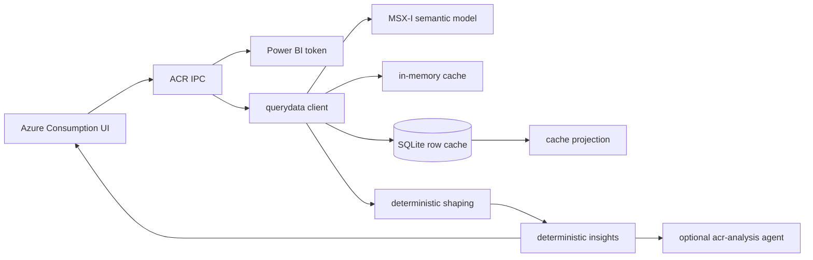

# Azure consumption analysis engine

The Azure Consumption surface reads the MSX-I Power BI semantic model directly, shapes the deterministic DSR response, caches reusable row sets locally, and computes portfolio/customer insights without asking a model to derive the underlying numbers.

AI is used only for the optional narrative analysis layer.

## Data path



Primary modules:

| Module | Responsibility |
|---|---|
| `desktop/services/acr-schema.js` | query construction, dimensions, measures, period resolution, fiscal ordering, DSR decoding, result shaping |
| `desktop/services/acr-querydata.js` | Power BI HTTP execution, retries, caching, freshness, progress, and public query surface |
| `desktop/services/acr-request-scheduler.js` | shared semantic-model query admission and capacity cooldown |
| `desktop/services/acr-row-cache.js` | persistent SQLite row-cache reads, writes, identity/model scoping, and invalidation |
| `desktop/services/acr-cache-projection.js` | safe projection of a compatible broader cache into a narrower request |
| `desktop/services/acr-data-recovery.js` | bounded recovery probes for incomplete result sets |
| `desktop/services/acr-insights.js` | deterministic portfolio trend and opportunity facts |
| `desktop/acr-ipc.js` | renderer-facing ACR and snapshot handlers |

## Authentication and model identity

The Microsoft sign-in obtains a Power BI-scoped token for:

```text
https://analysis.windows.net/powerbi/api/.default
```

The query client uses the MSX-I querydata endpoint and the semantic-model identifiers declared by `acr-schema.js`.

Persistent cache identity includes the signed-in user and semantic-model context. A cache from a different identity or invalidated model fingerprint is not treated as an equivalent live result.

## Query execution

`acr-querydata.js` builds a query body and sends it to Power BI's synchronous `/explore/querydata` endpoint. Results are decoded from Power BI's DSR shape and checked against the query descriptor.

The client distinguishes:

- a well-formed result with zero rows
- a malformed/incomplete DSR envelope
- a Power BI service error embedded in an HTTP 200 response
- a capacity limit
- HTTP throttling or service unavailability
- authentication failure
- network/connectivity failure
- timeout

A legitimate empty result returns an empty data set. It is not retried as a transient failure.

## Capacity and retry control

The shared ACR scheduler prevents independent expandable sections and charts from overwhelming the Power BI capacity.

Execution behavior:

- query admission is bounded globally
- each request emits start, window, throttle, retry, done, and error progress
- `429`, `503`, and Power BI `CapacityLimitExceeded` responses enter a shared cooldown
- `Retry-After` is honored when present
- other transient failures use exponential backoff with jitter
- attempts and request timeouts are bounded
- retries wait outside the scheduler slot so one throttled query does not monopolize capacity

The UI receives the real phase rather than showing an indefinite generic spinner.

## Cache contract

ACR uses both memory and SQLite row caches. The cache preserves historical values and keeps the product usable when Power BI is temporarily unavailable.

Cache metadata includes:

- status: live, fresh, stale, partial, or missing
- data timestamp and age
- source
- refresh-in-progress state
- error
- incomplete months
- query and refresh keys

Cached data is always labelled as cached. The renderer must not imply that a stale or projected result is live.

### Background refresh

After roughly 22 hours, an eligible cached result is returned immediately and refreshed in the background. The active chart receives a refresh notification when newer data is available.

An explicit refresh bypasses the relevant memory/persistent cache and waits for the live query.

### Projection

A broader compatible cached row set can satisfy a narrower request when the projection can be proven by dimensions, measures, identity, model, and filter scope. Projection is deterministic and carries source/freshness metadata.

It is not a silent substitute for an incompatible query.

## Incomplete-data recovery

Some Power BI responses are syntactically valid but omit expected month/service coverage during capacity churn. Recovery is bounded:

1. inspect coverage
2. identify missing slices
3. run targeted probes under the same scheduler
4. merge only validated rows
5. report remaining incomplete months if recovery cannot finish

The engine does not loop indefinitely or declare a partial series complete.

## Deterministic portfolio insights

`desktop/services/acr-insights.js` computes facts from snapshot rows in `acr_account_metrics` and `acr_service_metrics`.

For each account or service it calculates:

- total
- latest and previous month
- month-over-month dollars and percent
- first-to-latest movement
- active-month count
- trailing monotonic streak

Portfolio output includes:

- latest, previous, and total ACR
- portfolio month-over-month movement
- largest account growers and decliners
- rising and eroding services
- newly active services
- accounts with at least three consecutive growth months
- accounts with at least three consecutive decline months
- largest-account concentration

Each human-readable insight card is generated from those computed facts and carries a severity.

No data returns `insufficientData: true` with a specific instruction to create the FY26/FY27 snapshot. The engine does not estimate missing revenue.

## Customer analysis integration

Per-account ACR is also supplied to `customer-insights.js`. It can support:

- expansion recommendations for rising services
- health reviews for eroding services
- new-landing reinforcement
- AI whitespace when research identifies AI intent but consumption contains no Azure AI service

When the source is `local-cache`, the customer analysis records the last successful fetch date and lowers the certainty of “current” claims.

## Optional AI narrative

The `acr-analysis` agent receives deterministic consumption facts plus customer profile, technology stack, opportunities, and milestones. Its job is interpretation and prioritization, not recomputation.

Provider selection follows the application contract:

- connected Copilot is used or fails explicitly
- Foundry is considered only when Copilot is not connected
- no configured provider produces a clear error

The report is rendered locally through `html-render.js`; no second formatting model call is made.

## Snapshots

The Azure Consumption **Snapshot** action writes fiscal account/service metrics to local SQLite for deterministic portfolio insight generation. Snapshots and row caches are different:

- row cache supports reliable interactive querying
- snapshot tables support stable cross-account analysis

Both are local and can be protected through the application's database backup.

## Failure behavior

- Missing Microsoft sign-in: prompt for the in-app Microsoft connection.
- Power BI token failure: preserve the authentication error.
- Capacity overload: show cooldown/retry state or the explicit terminal capacity error.
- Connectivity failure with usable cache: show cached rows and their timestamp plus the live-query error.
- Connectivity failure without cache: show the actual error.
- Incomplete recovery: show partial coverage and missing months.
- Invalid DSR descriptor: fail; do not render shifted or ambiguous columns.

## Verification

Focused tests:

```powershell
cd desktop
node --test services\__tests__\acr-schema.test.js services\__tests__\acr-insights.test.js services\__tests__\acr-row-cache.test.js services\__tests__\acr-data-recovery.test.js services\__tests__\acr-background-refresh.test.js services\__tests__\capacity-query.test.js
```
