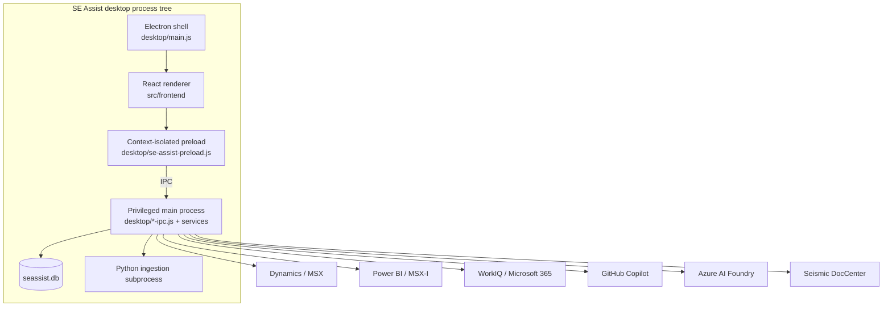

# SE Assist application architecture

This document describes the current SE Assist desktop application. It is the technical reference for process boundaries, data ownership, integrations, persistence, and the main end-to-end workflows.

SE Assist does **not** use the historical Node/PostgreSQL/Container Apps backend that was once explored in this repository. The running product is a local-first Electron application backed by SQLite.

The architecture diagrams separate three audiences: [solution overview](architecture/se-assist-overview.html) for showcasing the product, [runtime and trust boundaries](architecture/se-assist-runtime.html) for execution and data ownership, and [data workflow and components](architecture/se-assist-components.html) for inbound reads, processing, storage, UI dependencies and per-component agent/model/action lists. Overview and runtime have matching 1920x1080 PNGs; the workflow is a zoomable 3200x2880 reference poster with a matching PNG. All are linked from each view and the README.

The workflow separates API and MCP read connections from explicit external modifications, and distinguishes durable SQLite domains, files/configuration and transient caches/live buffers. It intentionally omits process/orchestration boxes; its storage-to-UI arrows are logical, application-mediated reads, not direct renderer database access. Model labels record configured Primary/Utility roles or an exact pin, rather than assume every installation uses the same model. Use its storage selector to trace consumers and **100% / readable** to inspect the visible agent tables.

## Runtime topology



### Electron shell

`desktop/main.js` owns the application lifecycle:

- creates the outer browser window
- loads the built renderer
- enforces single-instance behavior
- manages the Windows tray
- registers privileged IPC modules
- terminates tracked subprocesses during application shutdown

Closing the main window does not necessarily quit the application; the tray keeps background functions available.

### Renderer

`src/frontend/` is a React 18, Vite 6, and Fluent UI application. It renders product surfaces and owns transient UI state, but it has no direct Node.js, filesystem, token, SQLite, or remote-service access.

`src/frontend/src/App.jsx` is the route source of truth. `src/frontend/src/lib/navConfig.js` is the sidebar catalog and lists the tabs that can never be hidden. `src/frontend/src/lib/navPrefs.js` holds the tabs hidden by default and the user's saved show/hide choice.

### Preload bridge

`desktop/se-assist-preload.js` exposes narrow methods through Electron's context bridge. `src/frontend/src/electronBridge.js` wraps those methods for renderer use and returns explicit errors when an Electron-only capability is invoked outside Electron.

The bridge covers:

- SQL query/run and database backup operations
- authentication and provider status
- Dynamics, Power BI, WorkIQ, Seismic, external-link operations, and formatted milestone Teams messages
- customer workspace and task persistence
- workload creation, suggestion, discovery, templates, signals, and milestone AI
- meeting notes, transcript, summary, and Tasks
- Work Agent, Work Outputs (Deep Research), stored-email search, Secretary, assistant, and report generation
- org, account-team, schedule, and document search
- Stakeholder Influence Map, corrections, and AI analysis

Milestone Teams messages are formatted and copied to the Windows clipboard in the main
process, with the milestone name linked to its exact MSX record. The renderer then opens
the existing owner's Teams chat and explicitly prompts for Ctrl+V. Clipboard failures
block the launch; a launch failure is reported separately from a successful copy.
No message is pasted or sent automatically.

### Main process

The main process is the application's trust boundary. It:

- opens and migrates SQLite
- owns tokens and secure storage
- authenticates to external systems
- gathers and bounds grounding
- schedules model calls
- executes agents and tool loops
- launches and tracks Python ingestion
- validates IPC payloads
- performs backup, restore, filesystem, and shell operations

Renderer code should not duplicate these responsibilities.

## Persistence

The durable application database is:

```text
%APPDATA%\se-assist\seassist.db
```

`desktop/sqlite-ipc.js` opens the database, enables WAL mode and foreign keys, applies migrations, registers database IPC, and orchestrates restore.

Numbered SQL files in `desktop/migrations/` are authoritative. The current schema version is **36**.

### Data domains

| Domain | Representative tables | Ownership |
|---|---|---|
| Customer and sales data | `customers`, `opportunities`, `milestones`, `hok_activities`, contacts/account-team tables | Synced from MSX/Dynamics |
| Microsoft 365 evidence | `emails`, `meetings`, `teams_chats`, `teams_chat_messages` and customer-link/profile tables | Pulled through WorkIQ, normalized locally |
| Customer workspace | cached profiles, timeline, assets, local todos | Local authored state plus synced projections |
| Workloads | `workloads`, stages, actions, assets, templates, milestone links | Local authored state |
| Workload suggestions | suggestion, opportunity, milestone, dismissal tables | Local AI draft and approval state |
| Signal relationships | `signal_links` | Local assignment state |
| Meetings | `meeting_notes` and meeting signal links | Local authored notes, transcripts, summaries, and links |
| Tasks | `cached_customer_todos` | Local Tasks; not Dynamics HoK activities |
| Work Outputs | investigation, area, step, gap, and task-link tables | Local Deep Research subjects with independently retryable output state and tracked research gaps |
| Consumption | ACR snapshots, row cache, and metadata tables | Local cache of Power BI/MSX-I query results |
| Stakeholder influence | `stakeholder_overrides`, `stakeholder_assessments` | Local corrections and latest AI analysis per account; scores are recomputed, never stored |
| User state | roster, preferences, sync metadata, local settings | Local |

Synced source rows can often be pulled again. Workloads, notes, transcripts, Tasks, manual links, saved outputs, dismissal decisions, stakeholder corrections, and user configuration cannot be assumed recoverable from upstream services.

### Backups

`desktop/services/db-backup.js` provides:

- consistent online backups while SQLite is live
- synchronous pre-migration snapshots while the database is quiescent
- automatic launch snapshots no more frequently than every 20 hours
- a default retention of ten snapshots
- manual backup and export
- candidate validation before restore

A candidate restore must open as SQLite and contain the `customers` sentinel table. Restore closes the active database, preserves a rollback copy, replaces the file, and relaunches the full application so all readers reconnect to the restored state.

Backups are stored under the Electron user-data directory unless exported to a user-selected location.

## Authentication and secrets

### Microsoft sign-in

`desktop/services/entra-auth.js` uses MSAL's public-client interactive flow for Dynamics/MSX. Tokens are refreshed silently when possible.

The serialized MSAL cache and selected account metadata are stored through `desktop/services/secure-store.js`, which uses Electron `safeStorage`:

- DPAPI on Windows
- Keychain on macOS
- libsecret on Linux

If operating-system encryption is unavailable, SE Assist does not write a plaintext fallback.

Power BI uses the same Microsoft account but obtains a Power BI-scoped token for semantic-model queries.

### WorkIQ

WorkIQ has a separate Microsoft 365 Copilot identity and token cache. SE Assist invokes the bundled WorkIQ binary for sign-in and status, then uses the WorkIQ MCP client for Microsoft 365 reads.

Connection status is based on a live probe, not only the presence of a cached account. When an account is known and the session expires, the app can make bounded silent reauthentication attempts. Repeated failure stops automatic attempts and requires explicit user action.

### GitHub Copilot

`desktop/services/github-auth.js` implements GitHub's device flow. The resulting token is encrypted through `safeStorage`.

`desktop/services/copilot-provider.js` exchanges that token for Copilot access, lists the live model catalog, persists the selected primary and utility models, adapts request shape to provider capabilities, and reports rate limits to the shared scheduler. A request from an agent with a pinned model uses that model and reasoning level instead of the selection. If the model or reasoning level is unavailable, the request fails instead of stepping down reasoning or switching models.

### Azure AI Foundry

Foundry is optional and configured through environment variables. It requires:

- endpoint
- deployment
- either an API key or a complete service principal

Service-principal authentication acquires a Cognitive Services token with the client-credentials flow. Partial configuration is not treated as a usable provider.

### Seismic

`desktop/services/seismic-service.js` opens the real DocCenter application in a persistent hidden Electron partition. Interactive sign-in is shown only when required. Search calls execute inside that browser context, so the OIDC access token does not leave the page session.

## External data flows

### MSX/Dynamics sync

The renderer initiates sync through IPC. The main process acquires a Dynamics token and reads the configured CRM API, then upserts:

- customer accounts
- opportunities
- engagement milestones
- HoK activities
- customer and account-team contacts

Account-roster detection derives likely ownership from milestone deal teams, account teams, and saved roster state. The user reviews and saves the final TPID roster.

#### Active roster and non-destructive archiving

`tpid_config` is the authoritative active portfolio, including a legitimate empty list. User Home edits the complete list; saving replaces membership atomically. Detection edits a preview only and may include accounts from previous roles. Sign-in, scheduled sync, and WorkIQ ingestion never discover or adopt a new roster automatically.

Migration 036 defines `active_*` read views over the existing tables. Customers follow saved TPIDs; opportunities, milestones, account HoK activities, profiles, Tasks, suggestions, workloads, and their children follow their account relationships. Account-only communications disappear when their last active association is archived; shared communications remain available through active accounts without exposing archived account tags. Deliberately unassigned/internal work stays usable.

Archiving does not delete rows or change workload status, authored content, timestamps, notes, transcripts, links, dismissal decisions, or saved Work Outputs. Re-adding a TPID restores the existing records immediately and makes it eligible for new account pulls. Pulls resume their configured date windows; a user can explicitly backfill a wider gap.

Deep Research email search, saved research-subject lists, and the local-only Secretary scan follow the same active views. Archived-only sources and tags remain stored but cannot be opened or researched. Foundry Deep-Dives, native Anthropic consumption, and Influence Map work also hold roster leases, so accounts cannot be archived during an admitted request.

Main-process account guards reject archived deep links and actions. Renderer writes are checked against active views using connection-local temporary SQLite triggers, so a stale component cannot edit, delete, or create archived-account data. Account jobs, CRM sync leases, and actual ACR background requests prevent membership changes while admitted work is running. Closing a renderer releases its CRM leases.

Customer, milestone, contact, HoK, ACR, and capacity pulls use only active identifiers. Calendar/inbox/chat discovery can still enumerate general metadata to distinguish internal and customer work. Stored associations and deterministic account-name, alias, and contact matches exclude recognized archived-only items before body pulls and AI processing. Unknown/internal items and sources shared with active accounts remain usable; archiving is a portfolio boundary, not content redaction or a mailbox access restriction.

Work Agent queries refuse recognized archived-only account context. Email and meeting collection reads are metadata-first; archived results are excluded with an explicit notice, and known archived sources cannot be opened for full reads. If a search mixes active and archived sources, its unscoped summary is omitted with a notice; the agent can read the eligible source references for full evidence.

ACR row caches retain their original query scopes. New portfolio analytics snapshots are keyed by the sorted TPID list; legacy unscoped snapshots are preserved but never presented as current-roster totals. A changed roster explicitly requires a matching snapshot rather than showing old portfolio aggregates.

MSX auto-sync refreshes milestones and HoK activities while the application is running. Full customer and contact refresh remains an explicit operation.

### WorkIQ ingestion

`desktop/services/m365-ingest.js` orchestrates the normal product path:

1. probe WorkIQ with a real read
2. read the saved roster, scope account searches and message-body pulls, and exclude recognized archived-only discovery metadata
3. write temporary staged JSON
4. launch the corresponding Python pipeline under `tools/`
5. upsert normalized data into the same SQLite database
6. link evidence to customer TPIDs and rebuild per-account profiles
7. remove plaintext Teams staging files after ingestion

Packaged builds use the embeddable Python runtime shipped in `resources\python`. Development runs use `python` or `python3` from `PATH`.

AI enrichment generates account aliases and reviews uncertain customer links. It uses the GitHub Copilot utility-model role through the shared scheduler. If Copilot is unavailable, ingestion still performs deterministic exact-name matching and returns an explicit degraded result. It does not switch to Foundry or hide the missing enrichment.

Historical backfill uses wider date and result windows. Incremental and automatic ingestion pull recent data. Alias and review work is cached so later runs continue rather than starting over.

The email result lists `failedAccounts`, the roster accounts whose WorkIQ email search failed, so Action Center Secretary can report the gap instead of treating those accounts as quiet.

### Azure consumption

ACR, AI-capacity, and Foundry Deep-Dives views query Power BI semantic models in the main process. Queries are account- and filter-scoped, and responses are projected into renderer-safe shapes.

The ACR path has its own semantic-model query coordination in addition to the AI scheduler:

- bounded query concurrency
- request logging and progress
- capacity throttle/cooldown detection
- bounded recovery probes
- memory and persistent row caches
- freshness metadata
- user-requested refresh that bypasses the appropriate caches

When a live query is unavailable but a matching persistent cache exists, the UI explicitly identifies the cached source and its data timestamp. It does not label cached data as live.

Anthropic spend is a separate, native `$ ACR` query scoped to `F_ACR[AdjustmentFlag] = 'XCR - Anthropic'`, not an estimate from Foundry tokens. On both portfolio and account pages, **Apps** contains **Anthropic consumption (XCR)** directly below Foundry Models. Apps starts collapsed; expanding it loads completed-month USD totals and trends for the selected accounts/fiscal years, with customer drill-down in the portfolio. Apps remains available if the ordinary ACR overview fails. Product filters do not apply to this card. Ordinary ACR queries remain scoped to `N/A`, so their totals, charts, hierarchies, and snapshots do not silently change. Anthropic queries reuse the ACR scheduler, progress, refresh, and identity-scoped persistent cache, with the adjustment scope included in cache matching to prevent cross-source reuse. No financial-record IDs or unverified Claude-model allocations are requested.

Foundry Deep-Dives uses a separate, roster-scoped rolling-90-day query path. Portfolio and customer-detail responses are cached in memory for 15 minutes per signed-in identity; manual refresh bypasses that cache. Usage rows are not written to SQLite. The renderer labels the query time separately from the semantic model refresh time, and a model-metadata failure is returned as an explicit freshness warning without replacing valid usage results.

## AI architecture

### Catalog and runtime

`desktop/services/agents/catalog.js` declares 23 feature-specific agents. `desktop/services/agents/runtime.js` resolves:

- instruction/knowledge blocks
- grounding tools
- optional conversation memory
- primary or utility model role, or a pinned Copilot model and reasoning level
- token, timeout, and reasoning settings
- tool-loop constraints
- source/model attribution

`desktop/app-ipc.js` binds catalog entries to prompt builders and deterministic grounding functions. The catalog describes a capability; the IPC implementation decides how current application data is gathered for it.

### Provider contract

Provider resolution is intentionally strict:

- connected GitHub Copilot is an explicit provider selection
- a connected but unavailable Copilot session causes a visible failure
- Foundry is used only when Copilot is not connected and Foundry is fully configured
- no provider produces a clear configuration error
- Work Agent is Copilot-only
- Secretary is Copilot-only and pinned to `gpt-5.6-luna` with high reasoning
- the Stakeholder Influence Map analysis is Copilot-only and uses the selected primary model

This prevents an authorization, quota, or model error from changing cost, identity, or behavior behind the user's back.

### Shared scheduler

`desktop/services/model-request-scheduler.js` serializes requests by default and provides:

- priorities: `foreground`, `normal`, and `background`
- configurable concurrency and start pacing
- queued-request cancellation
- safe in-flight deduplication by exact request key
- provider-wide cooldown state
- retry-header parsing
- a bounded cooldown retry
- global activity snapshots for the renderer

A cooldown longer than the configured automatic budget fails immediately with a retry time. When a long provider cooldown is discovered, other queued work receives the same explicit failure rather than waiting indefinitely.

### Rendering and artifacts

AI agents return structured or textual analysis. Report HTML is rendered locally by deterministic renderer functions and saved/opened as an artifact. SE Assist does not spend a second model call on formatting-only HTML generation.

## Primary workflows

### Customer analysis

1. Resolve the profile and customer TPID.
2. Read synced CRM, customer workspace, communications, ACR, capacity, and research inputs.
3. Compute deterministic insights where possible.
4. Run the requested dedicated agent.
5. render the result locally and preserve source/model attribution.

See [customer-analysis-engine.md](customer-analysis-engine.md).

### Workload suggestion

1. Read the user's saved TPID roster.
2. Gather the previous seven days of account-linked email, meetings, and Teams evidence.
3. Give the agent the candidate TPID/name set and bounded evidence.
4. Validate strict JSON and resolve every returned account to the roster.
5. reject duplicates against active workloads, current suggestions, and permanent account/concept dismissals.
6. persist suggestion drafts and source provenance.
7. load opportunities, SSP (`opportunities.owner_name`), and milestones deterministically when the user expands a draft.
8. approve through the standard workload creation path.

Opportunity inclusion gates milestone inclusion. Approval and suggestion deletion are transactional.

### Meeting transcript to Tasks

1. Fetch the Teams transcript through WorkIQ.
2. save the transcript against the meeting.
3. summarize it into recap text and structured actions.
4. allow the user to create local Tasks with customer and optional workload assignment.
5. use meeting/action keys to prevent duplicate creation.

### Secretary, Deep Research, Work Agent, and Work Outputs

- **Secretary** is hidden from Action Center for now (`SHOW_SECRETARY = false` in `ActionCenter.jsx`); `se-secretary-scan`, its catalog agents, and the model pin are unchanged. When shown, it reads only customer-linked email already stored by WorkIQ ingestion and makes no WorkIQ calls. Common time ranges resolve deterministically; an ambiguous range is resolved by a model call before any email is read.
  - Selection: `emails` rows with at least one `email_customer_links` row not marked `ai-rejected`, in the window by received (else sent) time. Copies sharing an Internet message ID merge; conversations marked done in `email_triage` are excluded.
  - Text: the full Graph body stored in `raw_json` (redacted at ingestion), then the condensed `body_text`, then the preview. Protected or text-less emails are listed as not assessed. The `signed_in_user_upn` saved by the Microsoft 365 (Entra) sign-in marks email the user sent; without it, sender is reported as unknown.
   - Links: before the model reads a body, `compactEmailLinks` (`desktop/services/email-content.js`) shortens each web address to host and path. It unwraps SafeLinks, drops query strings, fragments, and credentials, caps long paths, and marks any cut with `…`. Link text is kept. Batching measures the shortened body; the excerpt, protected-message detection, and the todo's `web_link` use the stored originals.
   - Freshness: the latest `email_sync.last_run_at` is reported as the last pull. Warnings come from the saved pull state: a failed or degraded email pull, `failedAccounts` the email pull could not search, a pull in progress, auto-ingest off, a last pull older than two hours (or two auto-ingest intervals, if longer), and undated emails.
  - With no customer-linked email or no completed email pull, the scan fails before any model call and names the pull to run.
  - Both the scope and scan calls run only on GitHub Copilot model `gpt-5.6-luna` with high reasoning, regardless of the User Home model selection. Without Copilot, the scan fails before any email is read. The coverage line reports the model that ran.
  - Secretary has no research action; its former Solve panel moved to Deep Research.
- **Deep Research** (`/deep-research`, `DeepResearch.jsx`, a child of Action Center that new users start with hidden) creates and reopens Work Outputs.
  - Search: `email-search.js` (`se-email-search`) reads every row in `emails`, linked to a customer or not, and makes no WorkIQ or model call. It takes `query`, `account` (a TPID), `cursor`, and `limit` (1–100, default 20; the page asks for 20).
    - Filters: with `account`, only email linked to that TPID is listed. Each word (at most 8; 200 characters) must match the subject, sender, To/CC, condensed `body_text`, or a linked account name. Account and words combine. `ai-rejected` links never count as account links.
    - Paging: copies sharing an Internet message ID merge and carry every account their copies are linked to. Results are newest first, undated last. `nextCursor` continues after the last email shown, not at an offset, so email pulled between pages cannot repeat one already listed. The page flags a changed total, stored count, or last pull between pages and offers Refresh.
    - Accounts: each response returns `accounts`, every TPID linked to stored email with its label and email count, for the picker; results carry their account labels as tags. Duplicate names add the TPID, and an account with no stored name is `Unnamed account (TPID …)`. An unknown TPID returns an empty list, never all mail.
    - The latest `email_sync.last_run_at` is shown as the last pull. Migration 034 dropped the retired Outlook folder tables (`mail_folders`, `mail_email_locations`, `mail_folder_sync`) and their WorkIQ sync is gone; stored email and its account links are unchanged.
  - Details: `se-email-detail` shows the stored full Graph body (else the condensed text or preview, labeled), recipients, accounts, and the stored Outlook link. Unreadable stored values are reported as warnings, not hidden. Protected emails cannot be sent to research.
  - **Deep Research** calls `se-work-output-open` with the email as the task, keyed on message ID and title, so the same email reopens its saved subject. Opening a subject runs, one after another, each of situation, actions, and reply that has not run yet; technical runs only when the user enters a technical question.
  - Gaps (`work-output-gaps.js`, migration 035): each distinct question in the outputs' gap lists becomes one gap, keyed on a hash of its normalized text after any "Output title: " inheritance prefix is stripped. Gaps are derived from the saved outputs on every read; `work_output_gaps` stores only what was added later: kind, status, answer, verbatim quote, query, sources, notes, error, model, and time. Research-coverage notices are not gaps. A researched question that no output lists any more stays visible as unlisted.
    - Classification: `se-work-output-gap-triage` sends up to 30 unclassified questions to the `work-output-gap-triage` agent (utility role) and classifies all or none of them as `m365`, `public`, `person`, or `limitation`. When the technical area has no question and is idle or needs input, it may also suggest one; the panel fills it in but never runs it. The panel classifies automatically after output runs; a saved classification failure suppresses that until the user retries.
    - Research: `se-work-output-gap-research` researches one listed `m365` or `public` gap. Work-data gaps run a focused WorkIQ search; public-docs gaps get a generic query from `work-output-public-query` that must pass `assertPublicQuery`. The `work-output-gap-answer` agent (primary role) judges the evidence, and `verifyQuote` keeps an answer only when its quote appears verbatim in the retrieved text. Outcomes are `answered`, `partial`, or `still_open`; failures save `failed`, or `blocked` on a 403. A partial answer is kept when a later search finds nothing better or fails.
    - Effects: answered and partial gaps are part of each listing output's saved dependencies, so those outputs become Needs refresh. A refresh gives the writer the research answers and removes answered questions from the output's gaps.
    - Concurrency: gap jobs run one at a time per subject and never alongside an output run. `se-work-output-cancel` with `area: 'gaps'` stops only the gap job. The panel's **Research open gaps** runs at most 5 gaps in sequence and stops at the first failure. Progress is held in memory only.
  - Subjects: `se-work-output-list` returns every investigation, most recently active first, including former Solve work; a subject whose saved task cannot be read is listed with its error. `se-work-output-remove` refuses a working subject, then deletes its areas, steps, and task links. Created Tasks and workloads are kept.
  - Runs only on GitHub Copilot with the selected model and never uses Foundry. Leaving the page cancels the active area.
- **Work Agent** investigates one action using live WorkIQ and public-web tools. Tool failures, missing permissions, and partial evidence remain visible in the result.
- **Work Outputs** persist four independent areas—situation, reply, actions, and technical. Each area owns status, revision, sources, gaps, errors, model, and checked time; retries update only the selected area. Each run reads the source email again live through WorkIQ.
- Work Agent and Work Outputs use the selected model; the Secretary pin does not apply to them. Work Outputs require GitHub Copilot.

### Stakeholder Influence Map

`/influence-map` (`StakeholderInfluence.jsx`) is available for every roster account. Every influence IPC handler refuses a TPID that is not on the roster. Migration 032 dropped the former opt-in table, `stakeholder_influence_settings`, and kept every correction and AI analysis.

1. `stakeholder-influence-store.js` reads one TPID's `email_customer_links` → `emails`, `meeting_customer_links` → `meetings`, and transcripts in `meeting_notes` (all excluding `ai-rejected` links), plus `customer_contacts` and `customer_account_team`. Nothing is fetched from WorkIQ.
2. `stakeholder-influence.js` resolves identities, drops broadcast items (more than 20 recipients or invitees), cancelled meetings, and duplicate email copies, and builds per-person signals with capped evidence (emails, meetings, transcripts, and links to open them). Each person also gets `microsoft`: the Microsoft people on the same message or meeting (not declined; transcript speakers count as present), counted once per email thread and once per meeting, most shared first, capped at 30 with `microsoftTotal`. It changes no score and is not in the AI context or its input hash.
3. It scores only non-Microsoft people: a weighted mean of email reach (0.25), looped in (0.2), initiative (0.15), meeting presence (0.2), and transcript conversation pull (0.2; omitted and rescaled without transcripts). Each component is normalized against the account maximum or a minimum floor. Scores, the hidden-influencer flag, and tags are recomputed on every read and never stored. Scores are relative to every non-Microsoft person, including excluded people, so excluding someone changes no other score.
4. **Analyze with AI** runs the `stakeholder-influence-analyst` agent through the shared scheduler, on GitHub Copilot only, with the selected primary model. One run per account at a time. `buildAnalystContext` sends the top 25 people as P# handles with their name, title, affiliation, score, signals, and tags, plus bounded transcript and email excerpts. Email addresses become `[email]`, excluded people appear only as "Hidden participant" with their words omitted, and notes and stance corrections are never sent.
5. `parseInfluenceAssessment` rejects the whole response if it is not valid JSON, refers to an unknown person or source, or has an invalid stance or confidence. It marks each quote verified only when it appears word for word in the text the model was shown. A truncated or invalid response saves nothing. People excluded while the model was running are dropped from the saved result.
6. One assessment per TPID is stored with provider, model, time, and an input hash. A changed hash marks it stale; an older analyzer version or unreadable JSON asks the user to delete it and analyze again. Deleting the analysis keeps corrections; it is refused while a run is active.

User corrections (stance, a note of up to 500 characters, or exclusion) override the AI per person.

## Failure contracts

Code and UI should preserve these rules:

- Never substitute Foundry for an explicitly connected Copilot session that failed.
- Never substitute another provider or model, or lower reasoning, for an agent pinned to a model (Secretary).
- Never run the Stakeholder Influence Map analysis on Foundry.
- Never claim a remote write or sync succeeded when only local state changed.
- Never interpret an empty result caused by schema/auth/query failure as “no data.”
- Never label cached ACR results as live.
- Never present stored email as live; Secretary reports its last pull time and anything that limits coverage, and Deep Research shows the last pull time.
- Never return a success-shaped response for a missing Electron capability.
- Never persist plaintext tokens when secure storage is unavailable.
- Never swallow a destructive restore, migration, or workload-linking failure.
- If deterministic ingestion continues without optional AI enrichment, label the result degraded and explain how to complete it.

Best-effort behavior is reserved for non-critical decoration or cleanup and should not change the meaning of the primary action.

## Historical Azure files

`infra/` and `.azure/deployment-plan.md` belong to an earlier cloud-backend experiment. There is no active `backend/` directory and the Electron runtime does not use its PostgreSQL, Container Apps, storage, or outbox design. Do not treat those files as current architecture or deploy them as the SE Assist application.
